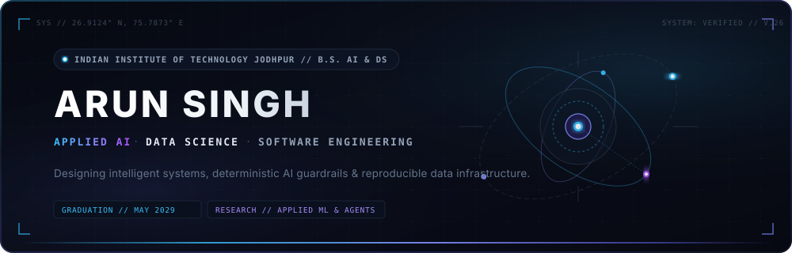

<!-- Custom Editorial Hero Banner -->

 

<!-- Social & Institutional Credentials -->

  
  &nbsp;
  
  &nbsp;
  

<!-- Editorial Section Divider -->

### 01 // PROFILE & PHILOSOPHY

I am an undergraduate student pursuing a **B.S. in Applied AI and Data Science at IIT Jodhpur** (Class of 2029). My technical focus centers on statistical machine learning, data engineering, and designing robust, real-world intelligent systems.

Rather than treating AI as an isolated theoretical abstraction, I prioritize **learning by building**: engineering production-style systems where machine intelligence solves tangible operational problems—ranging from computer vision traffic surveillance and financial anomaly scoring to multi-agent reasoning chains equipped with deterministic safeguards.

- **Institution**: Indian Institute of Technology Jodhpur (IIT Jodhpur)
- **Academic Focus**: Applied AI, Machine Learning, Statistical Inference & Linear Algebra
- **Engineering Philosophy**: First-principles problem formulation, clean architectural boundaries, and verifiable metrics over hype

  

### 02 // TECHNICAL ECOSYSTEM

#### **Core Toolchain (Active Development)**

  

| Discipline | Core Technologies |
| :--- | :--- |
| **Programming** | **Python**, **SQL**, **TypeScript** |
| **Machine Learning & AI** | **PyTorch**, **Scikit-Learn**, **Pandas**, **NumPy**, **OpenCV**, **LLMs & Multi-Agent Workflows** |
| **Data Storage & Schemas** | **SQLite**, Relational Modeling, Data Validation (**Pydantic v2**) |
| **Development & Systems** | **Git**, **GitHub**, **VS Code**, **Linux (Bash)**, **Google Colab**, **Jupyter Notebook** |

#### **Currently Deepening & Expanding**

  

*Deepening containerized inference microservices (**Docker**), scalable distributed databases (**PostgreSQL**), and asynchronous inference APIs (**FastAPI**).*

  

### 03 // SIGNATURE PROJECT PORTFOLIO

A curated selection of real, verified open-source repositories demonstrating applied AI, software engineering, and systems architecture:

<table>
  <tr>
    <td width="50%" valign="top">
      

        <code>// 01 — AI AGENTS &amp; ENTERPRISE DISCOVERY</code>
        <h3><a href="https://github.com/shanushekhawat7773-blip/cynbit-scout-AI">cynbit-scout-AI</a></h3>
        
Enterprise discovery &amp; lead intelligence copilot featuring dual-mode LLM/heuristic rules fallback (&lt;5ms), strict Pydantic v2 data contracts, prompt injection defense, and SQLite audit trails.

        

          
          
          
          
        

      

    </td>
    <td width="50%" valign="top">
      

        <code>// 02 — AGENTIC OPERATIONAL INTELLIGENCE</code>
        <h3><a href="https://github.com/shanushekhawat7773-blip/AegisFlow-AI">AegisFlow-AI</a></h3>
        
Agentic operational intelligence platform designed to isolate operational failures, conduct automated root-cause investigations, simulate solutions, and execute human-supervised actions.

        

          
          
          
        

      

    </td>
  </tr>
  <tr>
    <td width="50%" valign="top">
      

        <code>// 03 — FINANCIAL INTELLIGENCE &amp; RISK</code>
        <h3><a href="https://github.com/shanushekhawat7773-blip/FinGuard-AI">FinGuard-AI</a></h3>
        
Intelligent financial analytics engine engineered for transaction fraud identification, cash-flow forecasting, risk scoring, and explainable AI-driven decision rationale.

        

          
          
          
        

      

    </td>
    <td width="50%" valign="top">
      

        <code>// 04 — COMPUTER VISION &amp; AUTOMATION</code>
        <h3><a href="https://github.com/shanushekhawat7773-blip/TrafficGuard-AI">TrafficGuard-AI</a></h3>
        
AI-powered municipal traffic monitoring pipeline utilizing computer vision to detect infractions (red-light jumping, helmet absence, wrong-way transit) and compile digital challan records.

        

          
          
          
        

      

    </td>
  </tr>
</table>

  

### 04 // GITHUB ANALYTICS

  

    
    &nbsp;
    
  

  

    
  

  

### 05 // CURRENTLY EXPLORING

- 📐 **Foundational Machine Learning**: Rigorous study of convex optimization, matrix algebra, and probabilistic graphical models at IIT Jodhpur.
- 🤖 **Agentic Architectures**: Developing deterministic execution boundaries, multi-agent consensus, and tool-augmented LLM workflows.
- ⚡ **High-Throughput Data Systems**: Designing efficient stream ingestion, SQLite/DuckDB local querying, and reproducible analytical pipelines.
- 🛡️ **Defensive AI Engineering**: Mitigating prompt injection vulnerabilities, output drifting, and unverified decision states.

  

### 06 // CONNECT & COLLABORATE

  
  &nbsp;
  

 

  ENGINEERED WITH RESTRAINT · EDITORIAL DARK-TECH IDENTITY · 2026
    
  <a href="#master-hero" style="color: #64748b; text-decoration: none; font-size: 11px;">↑ RETURN TO TOP</a>

