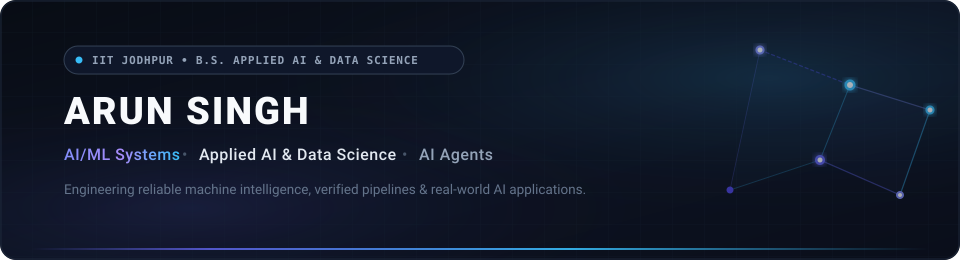

<!-- Hero Banner -->

 

<!-- Quick Social Badges -->

  
  &nbsp;
  
  &nbsp;
  

---

### 👨‍💻 About Me

I am an undergraduate student pursuing a **B.S. in Applied AI and Data Science at IIT Jodhpur** (Class of 2029). My focus centers on machine learning systems, statistical data modeling, and practical AI applications.

Rather than treating AI as an isolated concept, I concentrate on building real-world software where machine intelligence solves concrete operational problems—from computer vision traffic monitoring and financial anomaly detection to deterministic guardrails for multi-agent workflows.

- 🎓 **Academics**: B.S. in Applied AI and Data Science at **Indian Institute of Technology Jodhpur**
- 🎯 **Objective**: Growing into a disciplined AI/ML Engineer with strong fundamentals in algorithms, data engineering, and reliable deployment
- 🛠️ **Philosophy**: Learn deeply by engineering production-style systems from scratch

---

### ⚡ Tech Stack & Tools

#### **Core Technologies (Active Use)**

  

| Category | Technologies & Libraries |
| :--- | :--- |
| **Languages** | Python, SQL, TypeScript |
| **AI, ML & Data Science** | PyTorch, Scikit-Learn, Pandas, NumPy, OpenCV (Computer Vision), Multi-Agent Systems |
| **Data & Storage** | SQLite, Relational Schemas, Data Modeling |
| **Development & Environment** | Git, GitHub, VS Code, Google Colab, Jupyter Notebook, Linux / Bash |

#### **Currently Deepening & Expanding**

  

*Exploring containerized ML microservices (Docker), scalable relational backends (PostgreSQL), and high-throughput inference APIs (FastAPI).*

---

### 🚀 Featured Projects

A curated selection of real, verified repositories focused on applied machine intelligence and software architecture:

<table>
  <tr>
    <td width="50%" valign="top">
      <h4><a href="https://github.com/shanushekhawat7773-blip/cynbit-scout-AI">cynbit-scout-AI</a></h4>
      
Enterprise AI discovery and lead copilot featuring dual-mode LLM/rules fallback (&lt;5ms), strict Pydantic v2 schemas, prompt injection defenses, and SQLite audit trails.

      

        
        
        
        
      

    </td>
    <td width="50%" valign="top">
      <h4><a href="https://github.com/shanushekhawat7773-blip/AegisFlow-AI">AegisFlow-AI</a></h4>
      
Agentic operational intelligence platform designed to detect operational anomalies, trace root causes, simulate remediations, and execute human-verified actions.

      

        
        
        
      

    </td>
  </tr>
  <tr>
    <td width="50%" valign="top">
      <h4><a href="https://github.com/shanushekhawat7773-blip/FinGuard-AI">FinGuard-AI</a></h4>
      
Intelligent financial monitoring platform for real-time transaction fraud detection, risk scoring, cash-flow forecasting, and explainable AI insights.

      

        
        
        
      

    </td>
    <td width="50%" valign="top">
      <h4><a href="https://github.com/shanushekhawat7773-blip/TrafficGuard-AI">TrafficGuard-AI</a></h4>
      
Computer vision traffic monitoring pipeline that identifies vehicular violations (red-light jumping, helmet absence, wrong-way driving) and produces verifiable digital challans.

      

        
        
        
      

    </td>
  </tr>
</table>

---

### 📊 GitHub Activity & Insights

  

    
    &nbsp;
    
  

  

    
  

---

### 🎯 Current Focus & Learning Roadmap

- 📐 **Foundational Machine Learning**: Deepening knowledge in linear algebra, optimization, probability, and algorithmic rigor at IIT Jodhpur.
- 🤖 **Agentic Systems**: Architecting multi-agent reasoning chains with robust schema validation and hallucination-resistant guardrails.
- 📈 **Applied Data Science**: Building reproducible pipelines for statistical anomaly detection, ETL, and automated risk scoring.
- 🚢 **Software Engineering**: Strengthening code modularity, automated testing, and clean architecture practices.

---

### 📬 Connect With Me

  
  &nbsp;
  

 

  Crafted with precision • Minimalist dark-tech theme • Updated 2026

